<p align="center"></p>

# Travel Diary

<p align="center">
  
  
  
  <br><a href="https://itsaayush2004.github.io/TravelDiary/"><b>Open it live →</b></a>
</p>

A living, interactive 3D globe charting every place I've been — and the places I still dream of going. A single self-contained HTML file, built with Three.js, styled like an antique atlas.

**Live:** https://itsaayush2004.github.io/TravelDiary/

## Features

- Rotating 3D globe (Three.js) with a hand-drawn antique parchment texture
- Glowing matte markers for every visited place, plus a distinct golden house marker for home
- Black starfield + grid backdrop behind the globe
- A scrollable "Logbook" list, a progress ring toward a travel goal, and a wishlist of dream destinations
- Pixel-styled "Jersey 10" display font throughout
- A "Make your own atlas" panel so anyone can copy the code and fork their own version
- No build step, no server, no dependencies beyond a CDN script tag — open `index.html` and it runs

## Adding a place

1. Add an entry to `content/data.js` (slug, name, region, date, lat/lng, story) — or drop a `content/places/<slug>/info.txt` file (see that folder's `README.txt` for the exact format), which overrides `data.js` without touching any code.
2. Drop photos into `content/places/<slug>/1.jpg`, `2.jpg`, … (jpg, jpeg, png, or webp all work; up to 4).
3. Mark your home base with `home:true` — it gets its own house marker.
4. Commit and push — GitHub Pages redeploys automatically.

## Adding a dream destination

Same as above, but add the entry to the `DREAMS` array in `content/data.js` and drop photos into `content/dreams/<slug>/`.

## Customizing

- `GOAL` and `REPO_URL` are set at the top of `content/data.js`.
- Author name, role, bio, and profile photo live in `content/author/about.txt` and `content/author/dp.*`.
- Site branding (favicon, loader/splash image) lives in `content/branding/`.

## Local preview

```
python3 serve.py
```

then open http://127.0.0.1:8000/

## License

MIT — see [LICENSE](LICENSE). Copy it, fork it, make it yours.
